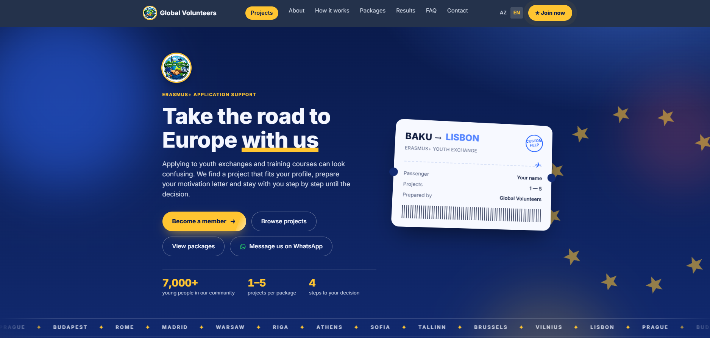
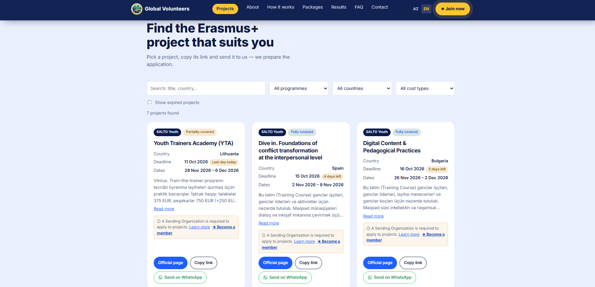

# Global Volunteers

**A bilingual (Azerbaijani / English) web platform that helps young people in Azerbaijan find and apply to Erasmus+ youth exchanges and training courses.**

🌐 **Live site:** [globalvolunteers.page.gd](https://globalvolunteers.page.gd)



---

## The problem

Erasmus+ opens real opportunities for young people: fully or partially funded trips to training courses and youth exchanges across Europe. But finding the right project, understanding the requirements, writing a strong motivation letter and meeting deadlines is confusing, especially for first-time applicants. Opportunities are scattered across several official portals, and deadlines pass quickly.

## The solution

Global Volunteers puts everything in one place:

1. **Discover** — a searchable, filterable list of current Erasmus+ and SALTO projects with deadlines, dates, countries and cost coverage.
2. **Choose a support package** — applicants pick the level of help they need.
3. **Get a prepared application** — the team selects projects that fit the applicant's profile and writes personal motivation letters.
4. **Visa and preparation** — document support and interview preparation after acceptance.

---

## Features

### For visitors
- **Two languages (AZ / EN)** with a one-click switch; page title, description and all content change together.
- **Project explorer** with live search and filters by programme, country and cost type (fully / partially covered).
- **Smart project cards** showing the country, deadline, dates and a countdown badge ("Last day today", "4 days left"). Expired projects are hidden by default and can be shown with one checkbox.
- **Quick actions on every project:** open the official page, copy the project link, or send it to the team on WhatsApp.
- **Package calculator** with outcome-based pricing: the visitor chooses "no acceptance / 1 acceptance / 2+ acceptances" and instantly sees what they would pay in total.
- **Interactive Europe map** — countries with open projects glow and pulse; clicking one flies a plane from Baku and lists that country's projects.
- **Add to calendar** — every project card downloads an `.ics` file with the deadline and reminders (3 days, 1 day, and the morning of the deadline). No server needed.
- **"Deadlines this week"** strip listing projects that close within 7 days.
- **"Get support"** button on every project (cards and map list) that opens WhatsApp with the project prefilled.
- **Dark / light mode** — a toggle in the header (☾ / ☀); the choice is remembered, and without a choice the site follows the device setting.
- **Animated boarding-pass hero** that rotates through European destinations.
- **Contact form** that sends by e-mail (Formspree) or falls back to a ready-made WhatsApp message.
- **Information dialogs:** Sending Organization membership, About us, FAQ, Terms and refunds, Privacy policy.




### For the administrator
- **Private admin panel** (`/?admin`) to add, edit and delete projects without touching the code.
- **Salto auto-fill:** paste the copied text of a Salto Youth page (Ctrl+A, Ctrl+C) and the form fills itself (title, country, dates, deadline, cost coverage, description); the admin reviews and saves.
- **Google sign-in** and **server-side security rules**: anyone can read the project list, but only the admin's verified Google account can write to the database. Other accounts are rejected by the database, not just hidden in the interface.
- The admin page is marked `noindex, nofollow` so search engines ignore it.

### Quality details
- **Responsive** layout for phones, tablets and desktops.
- **Accessible:** semantic HTML, ARIA labels and states for menus, dialogs and toggles, and support for `prefers-reduced-motion`.
- **Fast:** no frameworks, no build step, no heavy dependencies. Animations use `IntersectionObserver` and run only when needed.
- **SEO-ready:** canonical URL, Open Graph and Twitter meta tags, language-aware title and description.

---

## Tech stack

| Layer | Technology |
|---|---|
| Structure | HTML5 |
| Styling | CSS3 (custom properties, grid, flexbox, animations) |
| Logic | Vanilla JavaScript (no framework) |
| Database | Firebase Realtime Database (REST for reads) |
| Authentication | Firebase Authentication (Google sign-in) |
| Forms | Formspree with WhatsApp fallback |
| Fonts | Inter (Google Fonts) |
| Hosting | Static hosting |

---

## Project structure

```
global-volunteers/
├── index.html        # page structure and content (AZ + EN)
├── css/
│   └── style.css     # all styling
├── js/
│   ├── main.js       # settings, language switch, project list, filters, admin panel
│   ├── effects.js    # scroll animations, counters, boarding pass, package calculator
│   ├── salto-parse.js # reads copied Salto Youth page text for the admin form
│   ├── theme.js      # dark / light mode toggle
│   ├── extras.js     # Europe map, deadlines this week
│   └── europe-map.js # simplified Natural Earth country shapes (generated)
├── images/           # logo files and screenshots used in this README
├── README.md
└── .gitignore
```

## Run locally

No installation needed.

1. Clone or download the repository.
2. Open the folder in **VS Code**.
3. Install the **Live Server** extension and click **Go Live**, or simply open `index.html` in a browser.

## Configuration

Settings are at the top of `js/main.js` in the `CONFIG` object:

- `FORM_ENDPOINT` — Formspree address for the contact form (optional).
- `WA_NUMBER` — WhatsApp number used by the contact buttons.
- `SLOTS_LEFT` — number of places left this month (or `null` to hide it).
- `FIREBASE` — Firebase project settings for the project list and admin panel.

### Database security rules

The project list is public to read, but only one verified Google account can write:

```json
{
  "rules": {
    "projects": {
      ".read": true,
      ".write": "auth != null && auth.token.email === 'ADMIN_EMAIL' && auth.token.email_verified === true"
    }
  }
}
```

Replace `ADMIN_EMAIL` with the administrator's Gmail address. The Firebase `apiKey` in a web app is a public identifier, not a secret; access is controlled by these rules.

---

## Author

**Hikmat Nasrullazade** — [@nasrullazadehikmat](https://github.com/nasrullazadehikmat)

Built to make European youth opportunities easier to reach for young people in Azerbaijan.
